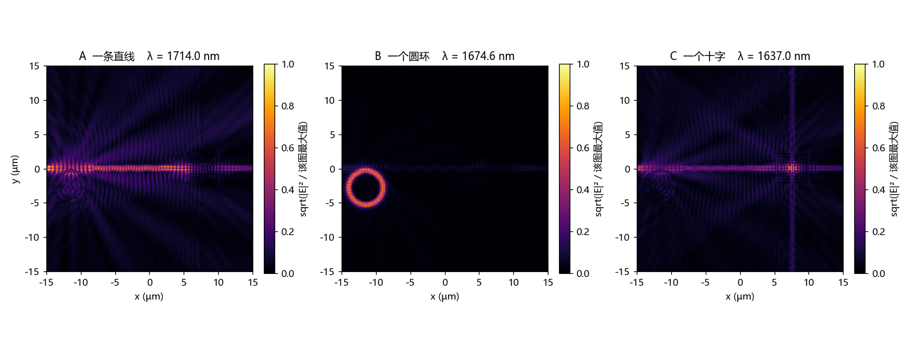
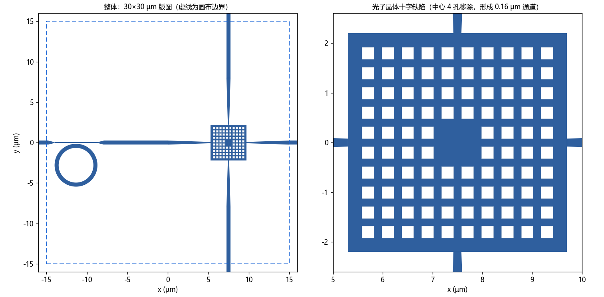

# 三张面孔 · 单一 2D 硅光结构的三幅光场图案

一个几何固定的二维结构（Si / SiO₂ / 空气，等效折射率模型），在同一入射端下**只改变波长**，
得到三幅未作后处理的 |E|² 场图：

| 图案 | 题目要求 | 本结构的结果 |
|---|---|---|
| A | 一条水平直线 | 一条自左端入射、终止于晶体入口的水平亮线 |
| B | 一个圆环 | 单一亮环，环外区域基本无光 |
| C | 一个十字 | 水平亮线与竖直亮线在交点相交 |



> 上图为仿真直接输出的 |E|² 场图（平方根压缩显示，使强场与弱场结构同时可见）。
> `figures/three_faces_linear.png` 为同一数据的线性色标版本（满量程取总线峰值），
> 更接近目视观感，**作为辅助**。

## 1. 题目要求

- 单一结构、单一入射端、仅改变波长，得到三幅可区分的光场图案。
- 材料限于 Si / SiO₂ / 空气；二维仿真，不涉及流片。
- 布局范围为 30 × 30 µm，所有结构位于该范围内。
- 图案为仿真直接输出的 |E|² 场分布，不作图像后处理。
- 三幅图需分别读作：一条线、一个环、一个十字。

## 2. 结构



```
布局 30×30 µm；仿真域 42×34 µm；网格 25 nm；仿真时长 12 ps
等效折射率：芯 2.6089 / 包层 1.444

总线    宽 0.50 µm，横贯画面
细颈    0.10 µm × 5.30 µm（x = −14.0 … −8.7），两端 0.8 µm 渐变
圆环    r = 2.40 µm，宽 0.50 µm，圆心 (−11.35, −2.80)，与细颈间距 0.10 µm
晶体    4.4 × 4.4 µm 方晶格，周期 0.40 µm、方孔 0.24 µm，共 96 孔
点缺陷  晶体中心移除 4 孔，形成 0.16 µm 宽的十字形通道
竖臂    宽 0.50 µm，经锥形过渡与十字通道相连，上下贯穿画面
光源    两端各一模式源（∓19 µm），右侧振幅为左侧的 0.35
```

光自左侧总线进入，在圆环处被选择性取走（对应图案 B 的波长）；在光子晶体十字缺陷处
被选择性转入竖直通道（对应图案 C 的波长）；其余波长沿总线通过（对应图案 A 的波长）。

## 3. 三幅图案

| 图案 | 波长 | 场图特征 | 判据（特征 ÷ 同高度局部背景） |
|---|---|---|---|
| A | 1714.0 nm | 仅水平亮线；环与竖直臂均不亮 | 竖直臂 1.38（无可辨识十字） |
| B | 1674.6 nm | 仅一个亮环；环后总线接近全暗 | 环 = 总线峰值的 115.5 倍 |
| C | 1637.0 nm | 水平亮线与竖直亮线于交点相交 | 竖直臂 8.06；上下强度比 0.84 |

三个波长在频率上等距（198.18 / 179.03 / 174.92 THz），因此单次仿真的全画布监视器
可直接给出三幅切片。

## 4. 成像机制

**(a) 图案 A：竖直方向不导通。**
该波长不在竖直通道的导带内，光沿总线传播；圆环亦未处于共振。因此画面中只有一条水平线，
无需对水平光作遮挡。

**(b) 图案 B：圆环处于临界耦合。**
圆环与细颈间距 0.10 µm，耦合强度与环自身损耗率相当，总线能量被大量转移至环内
（实测环后总线为入射的 2.7%），环内形成较强驻波。耦合强度取决于环下方波导的宽度：
相同间距置于 0.50 µm 均匀总线上时不产生吸收。

**(c) 图案 C：光子晶体十字缺陷。**
该晶格在 1576–1750 nm 呈禁带（透过率 0.002）；中心移除 4 孔后形成 0.16 µm 宽的缺陷通道。
水平光沿通道到达交叉点后转入竖直通道，自上下两臂输出，强度基本对称。
晶格在交叉点左右对称（各 5 列）是竖直输出沿臂轴的前提。

**(d) 波长选择性。**
竖直输出在 1513 → 1760 nm 由 5.5% 降至 0.2%（约 27 倍）。三幅图案得以共用同一结构，
依赖于这一随波长变化的导通条件。

## 5. 数值（同一份仿真数据）

| 量 | 值 |
|---|---|
| 图案 B：环 / 总线峰值 | 115.5 |
| 图案 B：环后总线 | 0.03 |
| 图案 C：上臂 / 下臂（相对总线） | 0.20 / 0.16；上下比 0.84 |
| 图案 C：竖直臂 ÷ 局部背景 | 8.06 |
| 图案 A：竖直臂 ÷ 局部背景 | 1.38 |
| 竖直输出的波长对比（1513 → 1760 nm） | 约 27 倍 |

## 6. 目录

```
figures/     三幅图案（线性与平方根两种表示）及结构图
geometry/    几何描述 sketch_v15.txt（纯文本，图与仿真同源）与绘图脚本
versions/    迭代版本的结构图记录，见 versions/INDEX.md
```

## 7. 方法

- 求解器：Ansys Lumerical FDTD，二维；等效折射率法（2.6089 / 1.444）。
- 网格 25 nm（局部覆盖盒包含全部结构）；仿真时长 12 ps；频率点 2001。
- 几何由一份纯文本 sketch 定义，绘图与建模读取同一文件，两者保持一致。
- 场图为全画布功率监视器的 |E|²，直接输出三个频率切片，未作后处理。

## 8. 已知限制

- **散射尚未处理。** 晶体与圆环在非共振波长仍向外辐射，画面中存在散射光晕与条状纹理。
  本版仅保证图案可辨识，未针对散射作优化。
- 图案 C 的竖直强度依赖右侧光源：右源振幅增大则十字更亮，同时图案 A 的右半也更亮。
  本版取 0.35 作为折中。
- 图案 B 的圆环在非共振波长仍保留约 −10 dB 的轮廓，这是就近耦合的结果。
- 全程为二维等效折射率模型：未作三维全矢量验证，未作网格收敛认证，不涉及流片。

---

本仓库仅说明该结构达到题目要求；几何演进记录见 `versions/`。
